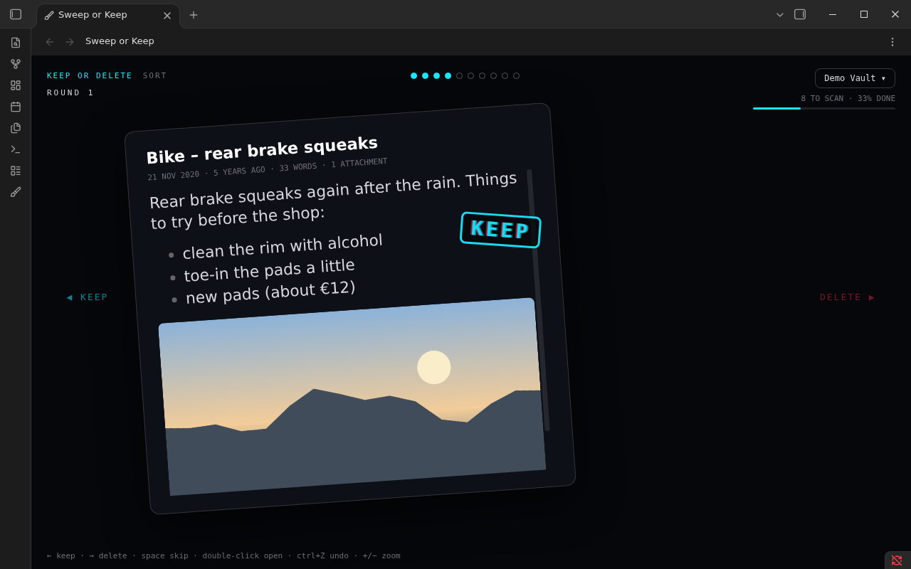
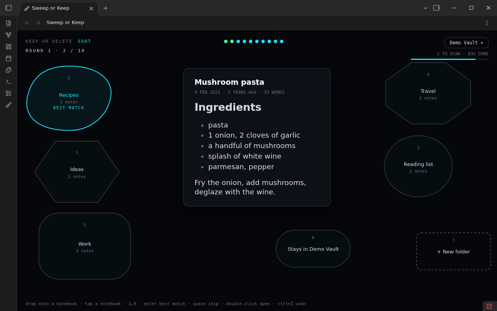
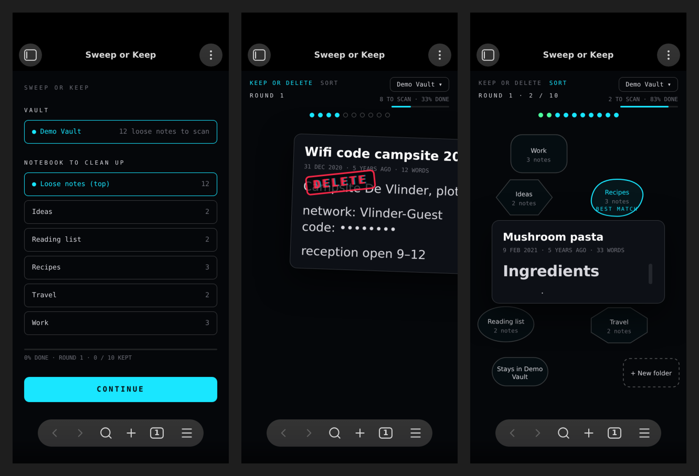

# Sweep or Keep

Clean up a cluttered vault one note at a time, in rounds, on your computer or your phone.

1. **Keep or delete.** Your oldest notes come up one by one, shown as cards. Swipe a card
   **left to keep** or **right to delete**. Dots at the top fill up with each note you keep.
2. **Sort.** After a round of kept notes (10 by default), they come back one by one. Drag
   each onto the notebook (folder) where it belongs, or tap a notebook. "Stays here" and
   "+ New folder" are always there.
3. Next round.

Deleted notes go where your **Settings → Files and links → Deleted files** setting says, and
**undo** (the button under the card, or Ctrl+Z) brings them back.

## Open it
The brush button in the ribbon, or the command **Sweep or Keep: Open**. The start screen
asks which **notebook to clean up**: the loose notes at the top of the vault, or one of its
folders.

## Controls
| | Keep or delete | Sort |
|---|---|---|
| Finger or mouse | drag the card left / right | drag onto a notebook, or tap a notebook |
| Keys | ← keep · → delete | 1–9 a notebook · Enter the best match |
| Space | skip (comes round again) | skip |
| Double-click / double-tap, or O | open the note | open the note |
| Ctrl+Z / Backspace | undo | undo |
| Ctrl+scroll, pinch, + / − / 0 | zoom the note | zoom |

## Settings
- **Notes per round** (3–30).
- **Look**: Sweep's own dark look, or your theme's colours.
- **Other vaults**: names to switch to from the start screen (each needs this plugin too).

## Progress and sync
Progress is kept in the plugin's `data.json`, so with Obsidian Sync (or any sync that carries
`.obsidian/plugins`) you can stop on your phone and carry on on your computer. Keys are paths
relative to the vault.

## Best match
While you sort, the notebooks that fit the note best light up: **best match**, then a dimmer
**2nd** and **3rd**. Tap one, or press Enter for the best match. Sweep or Keep works this out
itself, on your device, from:
- **words** the note shares with the notes already in a notebook (two or more; rare words
  count more than common ones),
- **tags** and **links** between the note and that notebook's notes,
- the **notebook's name** appearing in the note,
- **where you sorted before**: notebooks you pick often weigh a little more.

When nothing fits clearly, nothing lights up.

**Matching by meaning (optional).** Another tool may write a meaning search into `data.json`:
`"suggest": {"note.md": [["Folder", 0.31], ["Other", 0.2]]}` (or simply `{"note.md": "Folder"}`).
Sweep or Keep then mixes that in. The plugin itself never sends your notes anywhere.

## Privacy
Everything stays in your vault. No network access, no telemetry.

## Install by hand
Copy `main.js`, `manifest.json` and `styles.css` from the latest release into
`<vault>/.obsidian/plugins/sweep-or-keep/`, then switch it on under Community plugins.

## License
MIT
